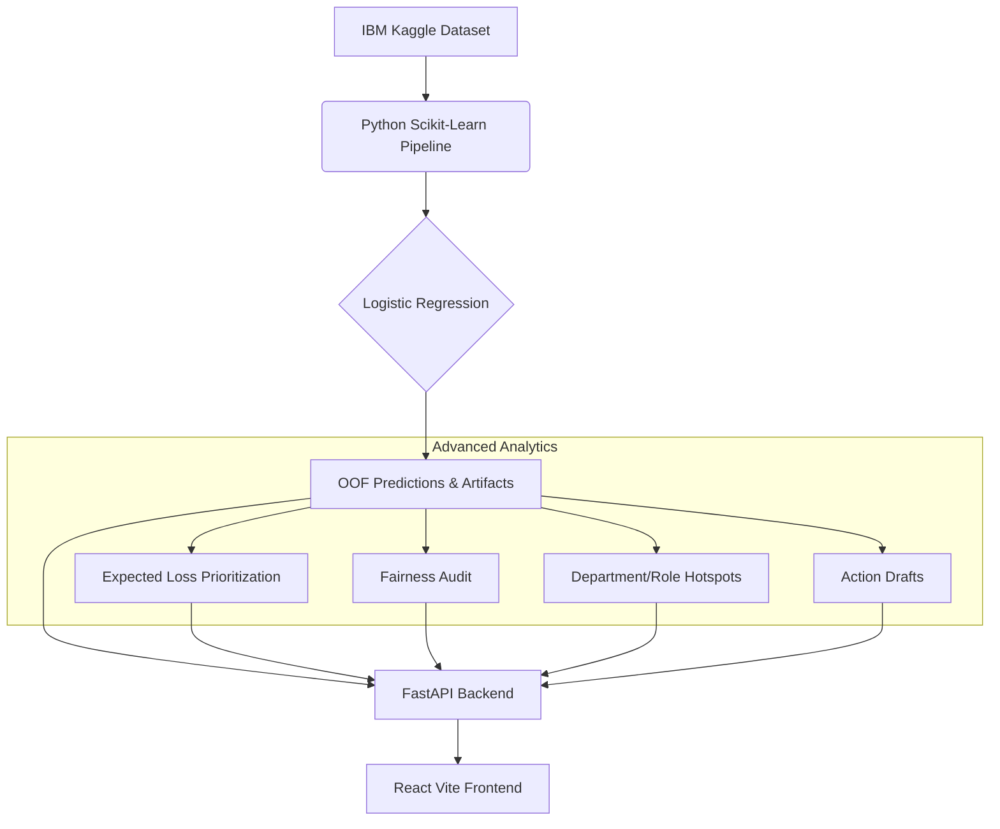

# TalentGuard - AI-Powered Employee Retention Intelligence

## 1. Problem Statement
TechNova Solutions is experiencing approximately 16% annual attrition among its 12,000 employees. Replacing an employee costs an estimated 6–9 months of their salary. HR currently has the capacity to conduct only 50 proactive retention interventions per month, making it critical to accurately identify the employees at highest risk of leaving who could be saved with targeted interventions.

## 2. Solution Overview
TalentGuard is an AI-powered intelligence platform that prioritizes retention efforts. It predicts employee attrition risk using historical data and provides a localized "What-If" simulator to estimate the impact of potential interventions (like salary adjustments or reduced overtime). The solution generates a precise Top-50 Watchlist with transparent, rule-based reasoning and actionable retention drafts.

## 3. Architecture Diagram


## 4. Technology Stack
- **Frontend**: React 19, Vite, TypeScript, Tailwind CSS
- **Backend**: FastAPI, Python 3.10
- **Machine Learning**: Scikit-Learn (Logistic Regression selected for explainability), MLflow
- **Testing**: Pytest

## 5. Setup and Installation Instructions

1. **Backend Environment Setup**:
    ```bash
    python -m venv venv
    .\venv\Scripts\activate # Windows
    pip install -r requirements.txt
    ```

2. **Data Acquisition**:
    Ensure your `kaggle.json` is configured or `KAGGLE_USERNAME` and `KAGGLE_KEY` are set.
    ```bash
    python -m src.download_data
    ```

3. **Pipeline Execution**:
    Run the pipelines to train models and generate all required artifacts.
    ```bash
    python -m src.train
    python -m src.watchlist
    python -m src.extras.run_analytics
    ```

4. **Start the API**:
    ```bash
    uvicorn api.main:app --reload
    ```

5. **Start the Frontend**:
    ```bash
    cd frontend
    npm install
    npm run dev
    ```

## 6. Business Benefits
- **Optimized Interventions**: Focuses HR's limited capacity (50 slots) on the highest-risk employees.
- **Explainability**: Logistic Regression coefficients provide clear reasons for the risk, increasing HR trust.
- **Financial Savings**: The Expected-Loss prioritization model translates raw risk into financial exposure, enabling ROI-focused retention strategies.
- **Simulation**: Enables "what-if" planning before executing expensive interventions like salary hikes.

## 7. Future Enhancements
- Automated LLM integration for highly personalized (but human-reviewed) retention emails.
- Dynamic data ingestion from internal HRIS (Workday/BambooHR).
- Deeper causal inference models to replace correlational simulation.

---

### Additional Documentation

**Model Choice:** 
Logistic Regression was selected over HistGradientBoosting. While HGB was trained concurrently, Logistic Regression was chosen because the performance gap (PR-AUC) was minimal, and Logistic Regression's linear coefficients allow for strict, deterministic feature contribution explainability (`src/explain.py`).

**Analytics Commands:**
- `python -m src.extras.run_analytics`: Generates Expected Loss, Fairness Audit, Hotspots, and Action Drafts.

**API Endpoints:**
- `GET /health` - System health
- `GET /api/v1/metrics` - Training metrics
- `GET /api/v1/watchlist` - Top 50 risk watchlist
- `GET /api/v1/watchlist/download` - CSV download
- `POST /api/v1/what-if` - Simulator
- `GET /api/v1/analytics/expected-loss` - Financial prioritization
- `GET /api/v1/analytics/fairness` - Demographic audit
- `GET /api/v1/analytics/hotspots` - Departmental risks
- `GET /api/v1/analytics/action-drafts` - PENDING_APPROVAL drafts

**Artifact Locations:**
All generated files are stored securely in `outputs/`. This includes `watchlist.csv`, `metrics.json`, `fairness_audit.json`, `top50_by_cost.csv`, and `retention_action_drafts.json`.

**Limitations & Troubleshooting:**
- **Probabilistic, Not Causal**: The simulator estimates risk sensitivity based on correlated historical data. It does NOT guarantee retention.
- **Fairness Constraints**: The fairness audit is a descriptive diagnostic, not a legal certification.
- **Troubleshooting**: If endpoints return 404s, ensure the analytics pipeline (`python -m src.extras.run_analytics`) has been executed successfully.
